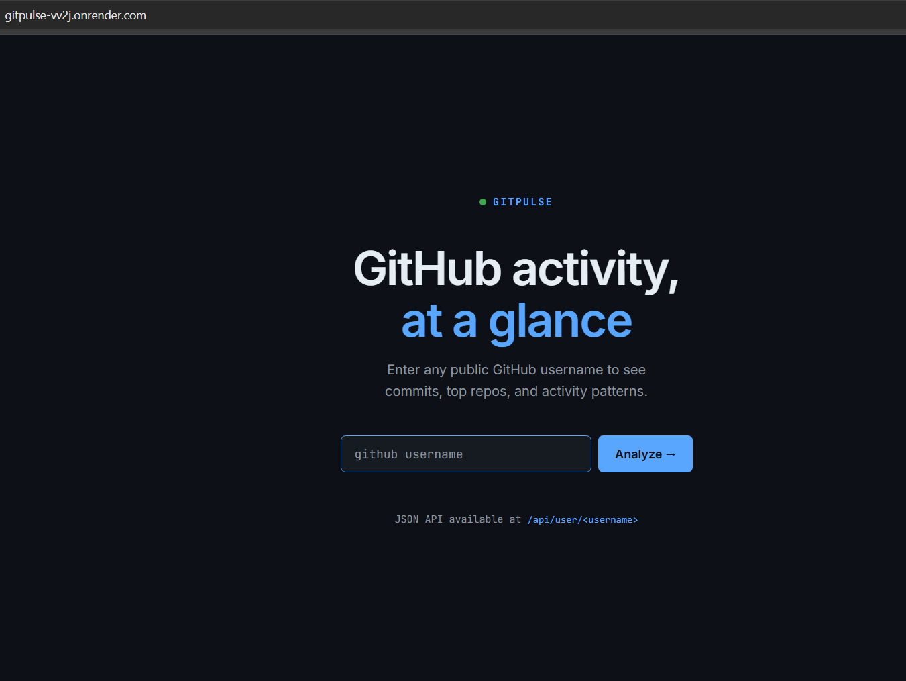
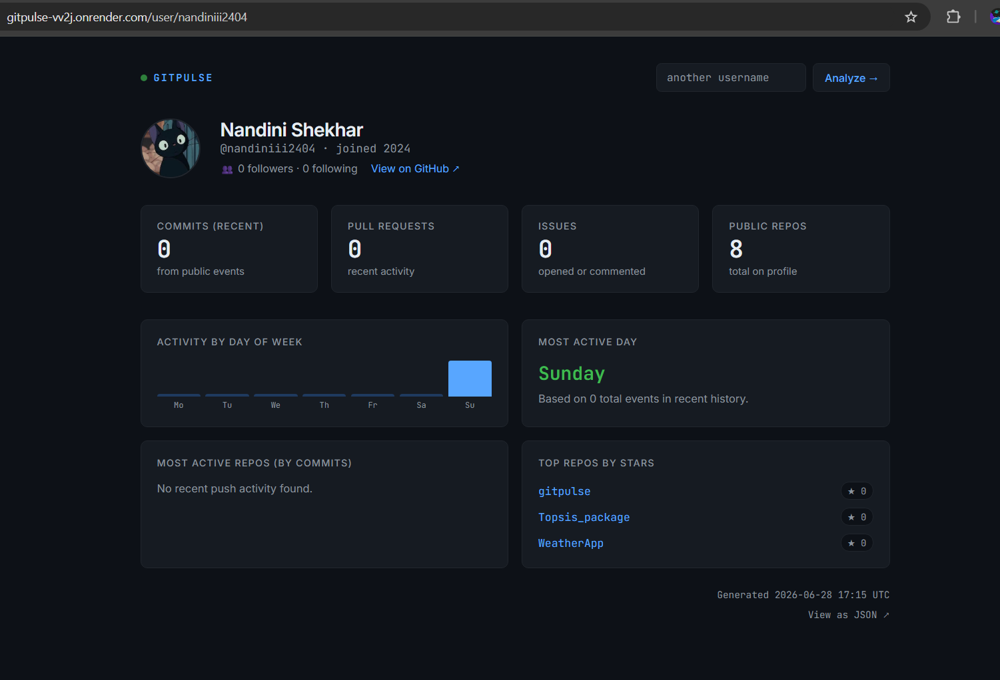

# GitPulse

GitHub activity summarizer — live at [gitpulse-vv2j.onrender.com](https://gitpulse-vv2j.onrender.com)
## Setup

```bash
pip install -r requirements.txt
python app.py
```

Then open http://localhost:5000

## Optional: GitHub token (recommended)

Without a token the GitHub API allows ~60 requests/hour. Add a token for 5,000/hour:

```bash
export GITHUB_TOKEN=ghp_your_token_here
python app.py
```

Generate a token at https://github.com/settings/tokens — no scopes needed for public data.

## Routes

| Route | Description |
|-------|-------------|
| `GET /` | Search landing page |
| `POST /` | Redirects to dashboard (form submit) |
| `GET /user/<username>` | Web dashboard for a user |
| `GET /api/user/<username>` | JSON API response |

## JSON API example

```
GET /api/user/torvalds

{
  "user": {
    "login": "torvalds",
    "name": "Linus Torvalds",
    ...
  },
  "activity": {
    "commit_count": 12,
    "pr_count": 0,
    "top_repos": [...],
    "most_active_day": "Monday",
    "day_chart": { "Monday": 5, "Tuesday": 3, ... },
    "recent_commits": [...],
    ...
  },
  "generated_at": "2025-01-01 12:00 UTC"
}
```

## Screenshots

### Home Page


### Dashboard



## Notes

- Activity data is pulled from the GitHub public events API (last ~90 events, roughly 30 days)
- Stars/repo info pulls from the user's public repo list
- No database needed — all data is fetched live
